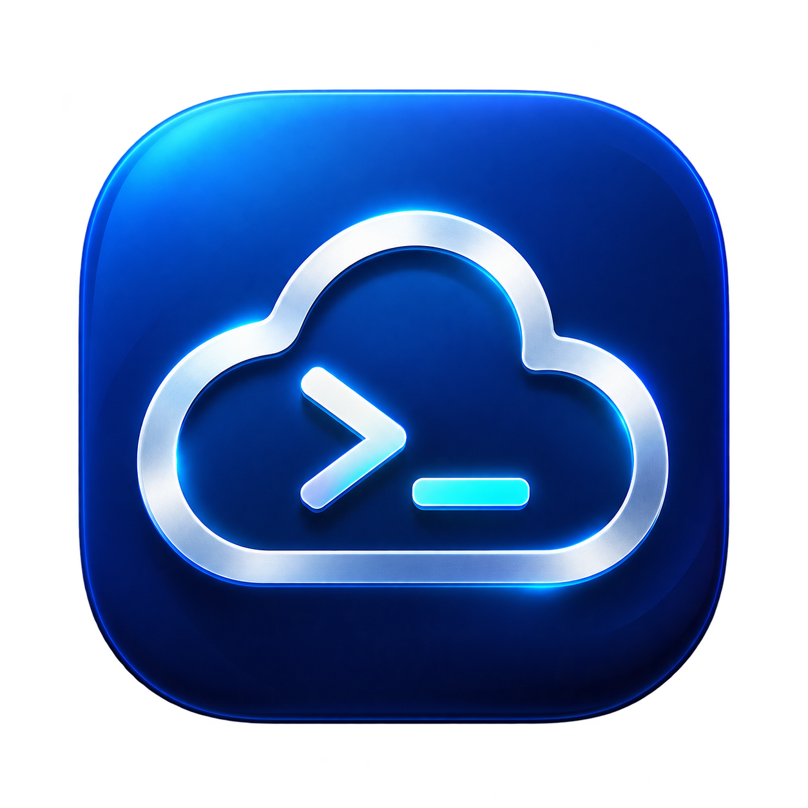

# OCI SSH Manager para macOS

Base de una aplicación gráfica para registrar y conectar máquinas por SSH. Incluye una interfaz gráfica en Python/Tkinter y conserva el menú de terminal original.

## Tecnología propuesta

Python 3 + Tkinter/ttk para la primera versión: permite reutilizar la persistencia JSON y las funciones SSH actuales, con pocas dependencias. SwiftUI es una alternativa para una aplicación con interfaz nativa de macOS, pero requiere trasladar la lógica a Swift y trabajar con Xcode.

## Primera interfaz propuesta

- Lista principal de máquinas activas con nombre, IP y usuario.
- Botones: Agregar, Editar, Conectar y Archivar.
- Vista de archivadas con opción de restaurar.
- Formulario con selector de sistema y selector de archivo de llave privada.
- Usuarios iniciales: Ubuntu `ubuntu`, Oracle Linux `opc`, Rocky `rocky`; editables.

En esta primera versión gráfica, Conectar abrirá Terminal para la sesión SSH interactiva. OpenSSH mostrará la huella y pedirá confirmación explícita. Integrar una terminal dentro de la ventana queda fuera del alcance inicial.

## Código actual

- `main.py`: menú de terminal.
- `storage.py`: validación y registro JSON.
- `connection.py`: permisos 600 y conexión SSH con comprobación de host keys.
- `OracleSSH.command`: lanzador por doble clic.
- `LEEME.md`: guía del programa actual.

Registro local: `~/.config/oracle-ssh-cli/machines.json`. Las llaves permanecen en su ubicación original y no deben incluirse en Git.

## Evolución futura

- Incluir Python y Tkinter dentro de un paquete distribuible.
- Recordar el perfil elegido entre aperturas.
- Añadir búsqueda y ordenamiento cuando crezca la lista.

Este proyecto administra conexiones SSH; no administra recursos mediante la API de OCI.

## Interfaz gráfica disponible

Abre `OCI SSH Manager.app` con doble clic. Mantén la app en esta carpeta junto a los módulos Python (este lanzador local todavía no incluye Python dentro del paquete).

La ventana permite agregar, editar, conectar, archivar y restaurar. Usa el registro existente y propone el perfil `Pro`, confirmado en este Mac; puedes cambiar el nombre en la ventana.

Cada conexión abre una pestaña nueva en la ventana frontal de Terminal y aplica ese perfil únicamente a la nueva pestaña. Si no hay ventana, crea la primera. Las sesiones existentes se mantienen independientes. No modifica tu perfil predeterminado. SSH conserva sus confirmaciones de huellas y contraseñas dentro de Terminal.

macOS puede solicitar Automatización para Terminal/System Events y Accesibilidad para el proceso que inicia la app. Si se deniega, la app muestra el error y no envía el comando SSH a una pestaña existente. Revisa Ajustes del Sistema > Privacidad y seguridad. No cierres ni cambies la pestaña durante la breve apertura.

Para el Python 3.13 de Homebrew de este Mac se requiere `brew install python-tk@3.13`.

`OracleSSH.command` sigue abriendo el menú de terminal anterior. `OracleGUI.command` abre la interfaz gráfica.

## Comprobaciones automatizadas

Ejecuta `PYTHONDONTWRITEBYTECODE=1 python3 -m unittest discover -s tests -v`. Comprueban permisos, persistencia, archivo/restauración, entradas inválidas y escapado de rutas al abrir Terminal. No conectan a una VM.

## Estado de verificación

Las pruebas de permisos, registro JSON, escapado de argumentos y rechazo de entradas inválidas pasaron. Se corrigió la identificación de pestañas: esta versión de Terminal las representa como ventanas en AppleScript. Ahora se detecta la sesión nueva por su TTY en todo Terminal y se cancela si aparecen varias sesiones nuevas simultáneamente. El usuario confirmó que se abre una pestaña con Pro; tras la corrección, dos aperturas de prueba ejecutaron comandos sin error y se verificó el perfil Pro. No se ha probado una conexión SSH real.

El botón **Probar pestaña** verifica la integración sin una VM ni una llave: imprime un mensaje en una pestaña con el perfil indicado. Si falla, no se ejecuta SSH.

Tkinter se instaló con Homebrew y se verificó que la ventana y el formulario abren. El lanzador prioriza el Python 3.13 instalado.

## Descripciones y orden

La descripción es opcional y se puede añadir o cambiar en el formulario. Se muestra en la lista principal. Los registros anteriores siguen funcionando sin este campo. Arrastra una fila sobre otra para moverla; al soltar, se guarda el orden. También funciona en archivadas, sin alterar el orden de las máquinas de la otra vista.

### Arrastre visual

Arrastra desde el icono ☰ de la primera columna. La fila completa, con todas sus columnas, sigue el cursor y las filas vecinas se desplazan suavemente para abrir espacio en la posición prevista. Al soltar, la fila se acomoda con animación y se guarda el orden. Esc cancela el movimiento.

## Explorador de máquinas y carpetas

La lista es un único árbol, como un explorador de archivos. Las carpetas se despliegan y contraen con la flecha; sus máquinas aparecen dentro. Las máquinas sin carpeta aparecen directamente en la raíz, sin una categoría artificial «Sin carpeta».

**Mostrar:** permite filtrar por Activas, Archivadas, Todas o una carpeta. Las vistas Todas y de carpetas incluyen activas y archivadas, distinguidas en Estado. La barra incluye **Nueva carpeta**, y puedes asignar una carpeta al crear o editar una máquina. **Raíz** en el formulario indica que no pertenece a ninguna carpeta.

Arrastra una máquina desde ☰ y suéltala sobre una carpeta del mismo árbol: el destino se resalta. Para sacarla de una carpeta, elige Todas o Activas y suéltala en el área vacía del árbol. Dentro de una carpeta, las filas se desplazan con animación para reordenarlas. Esc cancela. El estado desplegado/contraído se conserva al actualizar durante la sesión.

Las carpetas son grupos de la app, no directorios de tu Mac. Mover una máquina no mueve las llaves ni cambia su estado archivado. Se conservan las carpetas existentes y vacías en `~/.config/oracle-ssh-cli/folders.json`; las máquinas conservan el campo `folder`.

### Presentación y columnas

Tipografía de sistema compacta, encabezados discretos y filas uniformes. Arrastra los separadores del encabezado para ajustar el ancho de cada columna. Las barras de desplazamiento permiten consultar columnas o filas que no caben en la ventana.

### Herramientas e iconos

Agregar, Nueva carpeta, Editar, Archivar/Restaurar y Actualizar están encima del árbol. Conectar queda abajo a la derecha. Los botones son compactos y cada herramienta utiliza un icono de contorno dibujado localmente; las carpetas y el control de arrastre también usan imágenes, sin emojis.

En las vistas generales, solo aparecen carpetas con máquinas que coinciden con el filtro. Una carpeta vacía continúa disponible en el desplegable y el formulario para poder añadirle máquinas.

## Icono de la aplicación

Logo generado con la herramienta integrada de generación de imágenes. Original: `assets/app-icon.png`. Prompt: `assets/logo-prompt.txt`. El icono multirresolución de macOS está en `OCI SSH Manager.app/Contents/Resources/AppIcon.icns`.
